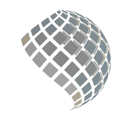
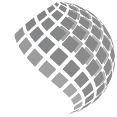
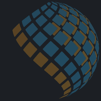

# Berp Sistemas — loader (spinner de carregamento)

Só o globo de pastilhas da logo, animado em loop infinito e sem emenda. Fundo transparente, canvas quadrado 512×512.

| Estilo | Movimento | Ciclo |
|---|---|---|
| **spin** | O globo gira enquanto uma onda de brilho percorre as pastilhas. | 2 s por volta |
| **pulse** | O globo fica parado e a onda passa pelas pastilhas em círculo, acendendo e apagando. | 1,5 s |
| **build** | As pastilhas se encaixam uma a uma, da esquerda para a direita, até montar o globo; depois saem na mesma ordem e o ciclo recomeça. | 2,6 s |
| **twinkle** | O globo fica completo e cada pastilha pulsa sozinha (encolhe, apaga e volta), cada uma num momento diferente. | 1,6 s |
| **breathe** | A bola "respira": as pastilhas se juntam até formar uma esfera compacta e depois se espalham com as frestas bem abertas antes de voltar ao normal. | 2 s |
| **whirl** | A bola compacta, gira rápido (duas voltas), vai expandindo enquanto desacelera, para exatamente no formato original e logo compacta de novo. | 2,5 s |
| **breathe_color** | O breathe começando em cinza: a bola compacta cinza, a cor se espalha do centro para fora na explosão, assenta colorida e volta ao cinza antes do próximo ciclo. | 2,5 s |
| **fill** | Barra de progresso no globo: ele aparece todo cinza e as pastilhas ganham cor uma de cada vez, da esquerda para a direita, cada uma com um pequeno "pulo". Com o globo todo colorido, ele fica um instante completo, volta ao cinza e recomeça. | 3,4 s |
| **skeleton** | Placeholder no estilo skeleton loading: o globo todo num cinza claro, com uma faixa de brilho atravessando na diagonal. Para fundo claro. | 1,6 s |
| **skeleton_dark** | O mesmo skeleton em tons escuros, para tema escuro (pensado para fundos perto de `#1c1f24`). | 1,6 s |
| **skeleton_color** | O skeleton com as cores da marca: o globo em tons pastel das próprias cores, e a faixa que passa acende cada pastilha na cor viva. Para fundo claro. | 1,6 s |
| **skeleton_color_dark** | O skeleton colorido para tema escuro: as cores ficam apagadas sobre o fundo escuro e acendem quando a faixa passa. | 1,6 s |
| **whirl_fast** | Igual ao whirl, mas com quatro voltas e mais rápido: acelera por duas voltas compactada e desacelera por mais duas enquanto expande. | 2,4 s |

Todos os estilos também existem em **escala de cinza**: mesmo nome com `_gray` no final (por exemplo, `berp_loader_whirl_fast_gray.json` e `avd_berp_loader_spin_gray.xml`). O cinza vem do brilho de cada cor, então as pastilhas laranja ficam num cinza mais claro que as azuis. O `breathe_color` e o `fill` não têm versão `_gray`, porque eles mesmos já vão do cinza ao colorido. Os skeletons também não: os neutros já são cinza e os coloridos têm a versão neutra correspondente.

Nos estilos que espalham as pastilhas (breathe e breathe_color), o globo é reduzido automaticamente para que a explosão inteira caiba no quadro de 512×512.

| spin | pulse | build |
|---|---|---|
|  |  |  |

| twinkle | breathe | whirl |
|---|---|---|
|  |  |  |

| whirl_fast | breathe_color | fill |
|---|---|---|
|  |  |  |

| skeleton | skeleton_dark | skeleton_color | skeleton_color_dark |
|---|---|---|---|
|  |  |  |  |

## Arquivos

| Arquivo | Uso |
|---|---|
| `berp_loader_<estilo>.json` | **Lottie** (60 fps). Android, iOS, Flutter, React Native, Web. |
| `berp_loader_<estilo>.svg` | SVG com animação CSS, sem dependências (web). Com `prefers-reduced-motion`, o movimento fica mais lento (e o spin para de girar). |
| `android/drawable/avd_berp_loader_<estilo>.xml` | Animated Vector Drawable nativo, sem biblioteca, 64dp. spin e pulse: Android 5+. Os demais usam keyframes: Android 6+ nativo; abaixo disso, carregue com `AnimatedVectorDrawableCompat.create(context, R.drawable.avd_berp_loader_build)`. |
| `preview/` | GIF e MP4 de cada estilo. |
| `tools/loader.py`, `tools/loader_tiles.py` | Geram tudo de novo: o primeiro faz spin e pulse, o segundo build, twinkle, breathe, breathe_color, fill, skeleton, skeleton_dark, skeleton_color, skeleton_color_dark, whirl e whirl_fast (ambos usam `../berp-splash/tools/pieces.json`). |

## Como usar

### Android — nativo, sem dependências

Copie o XML para `res/drawable/`:

```xml
<ImageView
    android:id="@+id/loader"
    android:layout_width="64dp"
    android:layout_height="64dp"
    android:src="@drawable/avd_berp_loader_spin" />
```

```kotlin
(loader.drawable as Animatable).start()   // roda até chamar stop()
```

Troque `spin` pelo nome do estilo que quiser (`pulse`, `build`, `twinkle`, `breathe`, `breathe_color`, `fill`, `skeleton`, `skeleton_dark`, `skeleton_color`, `skeleton_color_dark`, `whirl`, `whirl_fast`, ou qualquer um com `_gray`) em todos os exemplos. No spin e no pulse, as pastilhas entram na onda uma a uma na primeira volta; depois o ciclo fica contínuo.

### Android — Lottie

```xml
<com.airbnb.lottie.LottieAnimationView
    android:layout_width="64dp"
    android:layout_height="64dp"
    app:lottie_rawRes="@raw/berp_loader_spin"
    app:lottie_autoPlay="true"
    app:lottie_loop="true" />
```

### iOS (lottie-ios)

```swift
let loader = LottieAnimationView(name: "berp_loader_spin")
loader.loopMode = .loop
loader.play()
```

### Flutter (`lottie`)

```dart
SizedBox(width: 64, height: 64, child: Lottie.asset('assets/berp_loader_spin.json'))
```

### React Native (`lottie-react-native`)

```jsx
<LottieView source={require('./berp_loader_spin.json')} autoPlay loop style={{ width: 64, height: 64 }} />
```

### Web

```html

```

## Ajustar

Em `tools/loader.py`, `VARIANTS` define o ciclo (`period`, em quadros a 60 fps), se gira (`rotate`) e a intensidade da onda: escala mínima (`smin`) e opacidade mínima (`omin`) das pastilhas apagadas.

Em `tools/loader_tiles.py`, `VARIANTS` traz a linha do tempo de cada pastilha (quadros, valores e easing; `spread` é o quanto as pastilhas se afastam do centro, `tint` vai de 0 = cinza a 100 = colorido e `spin` é o giro da bola inteira), e `SHIFTS` define quando cada pastilha começa: no build segue a varredura da esquerda para a direita, no twinkle é sorteado, no fill cada pastilha acende 2 quadros depois da anterior (`fill_tracks`), no skeleton o brilho cruza na diagonal (as cores ficam em `palette`: base e brilho; nos coloridos, a base é a cor de cada pastilha clareada ou escurecida em direção ao fundo), e no breathe e no whirl as pastilhas de fora andam um pouco depois das de dentro.

```bash
python3 tools/loader.py out ../berp-splash/tools/pieces.json
python3 tools/loader_tiles.py out ../berp-splash/tools/pieces.json
# versões em escala de cinza: acrescente --gray
python3 tools/loader.py out ../berp-splash/tools/pieces.json --gray
python3 tools/loader_tiles.py out ../berp-splash/tools/pieces.json --gray
```

No whirl e no whirl_fast, `spin` é o giro da bola em graus ao longo do ciclo. Use sempre múltiplos de 360 no valor final, para ela parar no formato original.
