# Berp Sistemas — splash animado

A logo foi vetorizada (73 pastilhas do globo + letras de "Berp" e "Sistemas") e animada:

1. As pastilhas do globo surgem da esquerda para a direita, com giro e um leve "pulo" (0–1,1 s).
2. As letras de **Berp** sobem uma a uma (0,77–1,5 s).
3. **Sistemas** desliza da esquerda (1,17–1,9 s).
4. Tudo fica parado na logo completa até 2,5 s.

O quadro inicial é vazio (fundo transparente) e o final é a logo inteira, então dá pra sair da tela de splash a qualquer momento depois de ~1,9 s sem corte feio.


## Arquivos

| Arquivo | Uso |
|---|---|
| `berp_splash.json` | Animação **Lottie** (60 fps, 2,5 s, 1004×546, fundo transparente). Funciona em Android, iOS, Flutter, React Native e Web. |
| `berp_splash_animated.svg` | SVG com animação CSS, sem dependências. Para web (`` ou inline). Respeita `prefers-reduced-motion`. |
| `berp_logo.svg` | Logo estática vetorizada (estado final). |
| `android/drawable-v31/avd_berp_splash_globe.xml` | Ícone animado (só o globo, 1 s) para a **SplashScreen API do Android 12+**. |
| `android/drawable/ic_berp_splash_globe.xml` | Mesmo globo, estático, para Android < 12. |
| `preview/berp_splash.mp4`, `preview/berp_splash.gif` | Vídeo e GIF para conferir a animação, ou usar onde não há Lottie. |
| `tools/` | Scripts que geram tudo a partir da imagem original (para ajustar tempos/cores). |

## Como usar

### Android — tela de splash do sistema (Android 12+)

O Android 12 mostra o ícone num círculo, então ali vai só o globo. Copie `android/drawable*` para `app/src/main/res/` e adicione `implementation "androidx.core:core-splashscreen:1.0.1"`.

```xml
<!-- res/values/themes.xml -->
<style name="Theme.App.Starting" parent="Theme.SplashScreen">
    <item name="windowSplashScreenBackground">@android:color/white</item>
    <item name="windowSplashScreenAnimatedIcon">@drawable/ic_berp_splash_globe</item>
    <item name="postSplashScreenTheme">@style/AppTheme</item>
</style>

<!-- res/values-v31/themes.xml -->
<style name="Theme.App.Starting" parent="Theme.SplashScreen">
    <item name="windowSplashScreenBackground">@android:color/white</item>
    <item name="windowSplashScreenAnimatedIcon">@drawable/avd_berp_splash_globe</item>
    <item name="windowSplashScreenAnimationDuration">1000</item>
    <item name="postSplashScreenTheme">@style/AppTheme</item>
</style>
```

Coloque `android:theme="@style/Theme.App.Starting"` na activity de entrada e chame `installSplashScreen()` antes de `super.onCreate()`.

### Android — logo completa com Lottie

```gradle
implementation "com.airbnb.android:lottie:6.6.0"
```

Copie `berp_splash.json` para `app/src/main/res/raw/`:

```xml
<com.airbnb.lottie.LottieAnimationView
    android:id="@+id/splash"
    android:layout_width="match_parent"
    android:layout_height="wrap_content"
    android:layout_margin="48dp"
    android:adjustViewBounds="true"
    app:lottie_rawRes="@raw/berp_splash"
    app:lottie_autoPlay="true"
    app:lottie_loop="false" />
```

```kotlin
splash.addAnimatorListener(object : AnimatorListenerAdapter() {
    override fun onAnimationEnd(a: Animator) { startActivity(Intent(this@SplashActivity, MainActivity::class.java)); finish() }
})
```

### iOS (lottie-ios)

```swift
let view = LottieAnimationView(name: "berp_splash")
view.contentMode = .scaleAspectFit
view.loopMode = .playOnce
view.play { _ in /* ir para a tela principal */ }
```

### Flutter (`lottie`)

```dart
Lottie.asset('assets/berp_splash.json', repeat: false,
  onLoaded: (c) => Future.delayed(c.duration, () => Navigator.pushReplacementNamed(context, '/home')));
```

### React Native (`lottie-react-native`)

```jsx
<LottieView source={require('./berp_splash.json')} autoPlay loop={false}
  resizeMode="contain" style={{ width: '80%', aspectRatio: 1004 / 546 }}
  onAnimationFinish={() => navigation.replace('Home')} />
```

### Web

```html

```

## Ajustar a animação

Os tempos ficam na função `timing()` de `tools/build.py` (em quadros a 60 fps). Para gerar de novo:

```bash
pip install opencv-python-headless pillow numpy
python3 tools/vectorize.py tools/berp_logo_source.png tools/pieces.json   # só se trocar a imagem
python3 tools/build.py out tools/pieces.json
```
